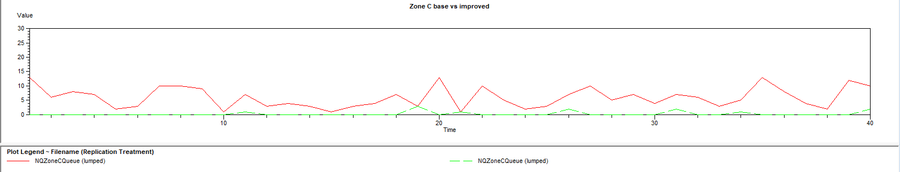

# Airport Baggage Handling Simulation (Arena)

**Where do bags get stuck in an airport baggage system, and what is the cheapest fix?**

*Zone C sorting queue across 40 replications: base model (red) vs. one officer reassigned to Zone C (green).*

## Business context
An airport's baggage system moves every bag through security screening, manual inspection (for flagged bags), sorting into three flight zones (A, B, C), reconciliation, loading preparation, a final scan and aircraft loading. Management wants to know where delays build up and which operational change would improve flow **without hiring extra staff**.

**Model scope:** discrete-event simulation in Arena · time unit = minutes · each replication = one week (7 × 18-hour operating days) · **40 replications** with 95% confidence intervals.

## Approach
| Step | What I modelled | Idea |
|---|---|---|
| 1 | Base process flow | Bags assigned to a flight-zone group → screening → manual inspection (cleared or removed) → sorting → reconciliation → loading prep & final scan → loading |
| 2 | Operating rules | Congestion rerouting to the shortest sorting queue (tie-break A > B > C), reconciliation batches of 15 with a 20-minute timeout, loading batches of 10, failed final scans returned to screening with priority |
| 3 | Staffing | Resource schedules with two 30-minute breaks per day for sorting staff and security officers |
| 4 | Diagnose | Queue waiting time, queue length, resource utilisation and total time in system, split by standard vs. additional-security bags |
| 5 | Test alternatives | Proposed two changes and ran the most promising one as a second model for a direct comparison |

## Results
**Base model: two bottlenecks**
- **Zone C sorting** is the main bottleneck: average wait **19.6 min** (vs. ~3 min in Zones A and B), longest queue, and staff utilisation of **90.1%** (vs. 67–69% for the two-person teams in A and B).
- **Loading batches** wait 20–44 min on average (up to 85.6 min for Zone C), yet the loading team is only **24.3%** utilised. The delay comes from waiting for a full batch of 10, not from a lack of loaders.
- **Manual inspection officers** are only ~30% utilised, so there is spare capacity to move.
- Average time in system: **73.5 min** for standard bags, **81.3 min** for bags needing extra security checks.

**Alternative tested: move one manual inspection officer to Zone C sorting**

| Performance measure | Base | Alternative | Change |
|---|---|---|---|
| Zone C waiting time | 19.59 min | 1.66 min | **−17.93 min** |
| Manual inspection waiting time | 0.39 min | 4.47 min | +4.08 min (manageable) |
| Standard bag total time | 73.51 min | 70.72 min | −2.79 min |
| Additional-security bag total time | 81.34 min | 81.72 min | +0.38 min (almost unchanged) |
| Loading Batch C waiting time | 44.13 min | 34.26 min | −9.87 min (knock-on benefit) |

## Recommendation
- **Reassign one manual inspection officer to Zone C.** It removes the main sorting bottleneck at zero extra headcount, and the new wait at manual inspection stays small.
- **Next step:** add a 15–20 minute timeout to loading batch release, so batches leave before reaching 10 bags. This targets the remaining delay before loading and puts the under-used loading team to work.
- **To make the model more realistic:** add equipment breakdowns, multiple staff shifts, and time-dependent arrivals that follow flight peaks.

## Files
- `model/baggage_model_base.doe`: base Arena model
- `model/baggage_model_alternative.doe`: alternative with one officer moved to Zone C
  (both open in Rockwell Arena)
- `report/baggage_simulation_report.pdf`: full report with assumptions, limitations and results

> Built for University of Bath coursework (MN50753 Heuristics & Simulation).
